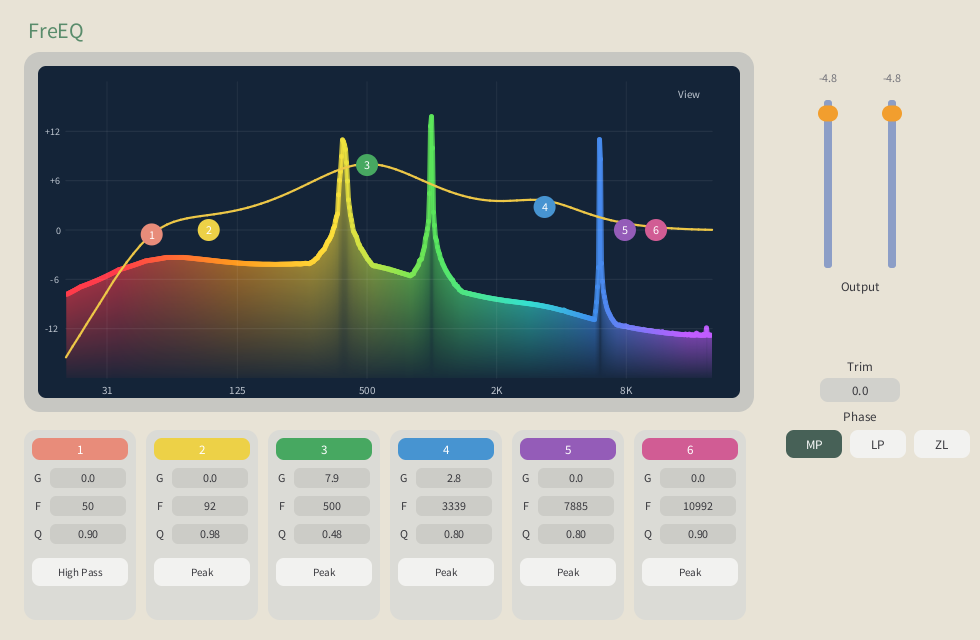
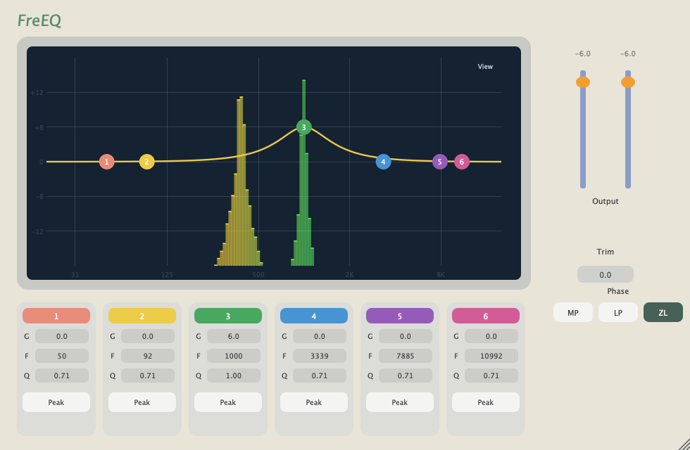

# FreEQ

## Summary

FreEQ is one six-band equaliser built twice. The Rust realisation is in [MistaMin/FreEQ](https://github.com/MistaMin/FreEQ) and links this SDK. Its face and spectrum are GoodLookin DRI (`goodlookindri` draws, `goodlookindri-shell` opens the window). The C++ comparison was built with JUCE 8.0.17-security and JUCE 9.0.5. That C++ tree is not in the FreEQ repository. The long impulses are played by [`BlockConvolver`](CONVOLVE.md).

This page is the measurement record: the filters, the test, the numbers after that convolver, and the playback code.



*OpenPlugin. Minimum phase is selected. The coloured fill is a 4096-point spectrum of the signal leaving the equaliser.*



*JUCE. Both JUCE builds draw this editor. Analog ZL is selected, and band 3 is a +6 dB bell at 1 kHz.*

## What was built

Each of the six bands is a peak, a high-pass, a low-pass, a low shelf, or a high shelf. Frequency runs from 20 Hz to 20 kHz. The phase control has three positions.

| Mode | What plays the audio | Reported latency |
| --- | --- | ---: |
| Minimum phase | six biquads in series | 0 |
| Linear phase | a 1024-tap impulse, peak at sample 512 | 512 |
| Analog ZL | a 1024-tap causal impulse | 0 |

A biquad remembers two input samples and two output samples and mixes them with five coefficients from the Bristow-Johnson formulas. A peak lifts or cuts a neighbourhood of one frequency. A shelf tilts one side of the spectrum. A high-pass and a low-pass ignore the gain control. Each is a single section, so the slope is 12 dB per octave.

Minimum phase adds no delay of its own. The sections still hold some frequencies back: a +6 dB bell at 1 kHz delays that region by about eleven samples, and frequencies far from the bell pass almost at once.

Linear phase copies the magnitude of those six sections and replaces every phase with zero. The inverse transform is an impulse that rings equally before and after its centre. Rotating it places the centre on sample 512, so every frequency is delayed by 512 samples, 10.7 ms at 48 kHz. The ringing before the peak is the price of a delay that does not depend on frequency.

Analog ZL exists because a biquad designed at the playback rate is a squeezed copy of an analogue filter. The squeeze is small at low frequencies and large near half the sample rate, so the top octave leaves the analogue curve. The six sections are designed as if the sample rate were sixteen times higher. Their magnitude is read at the 1024 frequencies of the real playback rate and turned back into an impulse. The half that would have sounded before time zero is discarded, and the last 64 samples are faded out. The peak sits on the first sample, so the reported latency is zero. The filter is still causal, so its delay still depends on frequency. The magnitude stays nearer the analogue shape through the top octave.

A +6 dB bell at 1 kHz measures 6.00 dB in minimum phase and in linear phase, and 6.03 dB in Analog ZL, in both realisations.

The picture behind the yellow curve is a separate 4096-point analysis, with a Hann window, a tilt of 3 dB per octave, and a fall of 24 dB per second. It was switched off for every timing run. The transforms that build the linear-phase and Analog ZL impulses run only when a control moves.

The editors are 980 by 640 points and keep that shape when the window is resized. The title on both faces is FreEQ. MP, LP, and ZL select the three modes.

## Versions

| Piece | Version | Commit | Date |
| --- | --- | --- | --- |
| OpenPlugin SDK used for these numbers | 0.1.1-beta.1 | `8ab9e16`, plus the convolver on top | 11 Nov 2026 |
| GoodLookin | 0.1.0 | `d8311fa` | 25 Oct 2026 |
| JUCE, first build | 8.0.4 | `51d11a2` | 18 Nov 2024 |
| JUCE 8 used for the final numbers | 8.0.17-security | `dabd5ad` | 2 Nov 2026 |
| JUCE 9 used for the final numbers | 9.0.5 | `d60b7a7` | 2 Nov 2026 |

The first JUCE tree kept the directory name `JUCE-8.0.4` after its checkout moved to the 8.0.17-security tag. JUCE 9.0.5 is a worktree beside it. Two other copies of JUCE, used by a different project, carry three local changes on top of 9.0.5. Those copies were not used for the numbers here.

OpenPlugin SDK 0.2.0 Beta adds the VST3, Audio Unit, and AAX shells in [SHELL.md](SHELL.md). Those shells call the same FreEQ processor. They are not part of the timing table above.

## How the cost was measured

Every run was 48 kHz, stereo, in blocks of 512. The tone was a 1 kHz sine of amplitude 0.25, and its phase continued across blocks. The clock was the processor time charged to the program, not the time on the wall. After the equaliser loop, the same blocks were copied again with no filtering, and that time was subtracted. One hundred percent means the equaliser fills one core for the length of the audio.

One equaliser was warmed for 187 blocks, about two seconds, and that warmup is not in the result. The clock then covered 750 blocks, exactly eight seconds. The pass was repeated six times. The first was discarded and the median of the other five was kept.

One hundred equalisers used the same eight seconds and the same warmup. The median was taken from three passes after one discarded pass. Each instance had its own filter memory and its own copy of the block. They were not chained.

Idle sets every band to a peak at 0 dB. One band sets band 3 to +6 dB at 1 kHz with Q equal to 1. Full makes band 1 a high-pass at 100 Hz, band 2 a low-pass at 8 kHz, and bands 3 to 6 peaks of +6 dB with Q equal to 2. The hundred-equaliser test used only the full setting. Trim was 0 dB. The spectrum display was off.

The three programs ran one after another. They were not run at the same time.

## The first playback, and why it was expensive

The first linear-phase and Analog ZL playback walked all 1024 coefficients for every sample, on both channels, and took a remainder to find the delay-line index. One equaliser used about 9% of a core. One hundred of them needed about nine cores. Minimum phase, six biquads and a logarithm on every sample, used about 0.18% in the Rust realisation and about 0.23% in JUCE.

JUCE documents that a time-domain FIR longer than 128 taps should be a frequency-domain convolution, and that this is already the faster choice from about 64 taps. The replacement is overlap-save. Up to 1024 new samples are written after a remembered stretch of input. The most recent 2048 samples are transformed, multiplied by the transform of the impulse, and transformed back. Only the new samples are kept.

That change, still using a plain complex transform in the Rust code and `juce::dsp::FFT` in the C++ code, brought one FIR equaliser from about 9% to 1.10% in OpenPlugin and to 0.50% in JUCE. A peak at 0 dB was also left out of the minimum-phase sum, and the meter took one logarithm per block. Idle minimum phase fell to 0.012% and 0.025%.

JUCE remained ahead on the long filters because its transform is vectorised. On this machine that is Apple's Accelerate library. The SDK already depended on `rustfft`, which uses Neon here, and the equaliser was not calling it.

## The SDK convolver

The library contract is [CONVOLVE.md](CONVOLVE.md). `BlockConvolver` in `crates/openplugin-dsp/src/convolve.rs` plans a 2048-point forward transform and its inverse with `rustfft`, stores the spectrum of an impulse of at most 1024 taps, and keeps one history per channel. `new` and `set_kernel` allocate. `process` does not. The inverse is divided by 2048, because `rustfft` leaves that scale to the caller.

A test in the same file runs the convolver and a direct 1024-tap walk on one impulse and one input, in uneven block sizes, and requires the outputs to agree within 0.0002.

FreEQ calls it from `process_fir`. The trim and the block meter stay in the equaliser. The impulse is still built by `design_linear` or `design_analog_zl` when a control moves, then handed to `set_kernel`.

## Results after the SDK convolver

One equaliser, percent of realtime. Latency is samples at 48 kHz.

| DSP | Load | OpenPlugin | JUCE 8.0.17 | JUCE 9.0.5 | Latency |
| --- | --- | ---: | ---: | ---: | ---: |
| Minimum | idle | 0.012 | 0.025 | 0.021 | 0 |
| Minimum | one band | 0.070 | 0.104 | 0.080 | 0 |
| Minimum | full | 0.111 | 0.229 | 0.227 | 0 |
| Linear | idle | 0.160 | 0.51 | 0.48 | 512 |
| Linear | one band | 0.160 | 0.51 | 0.50 | 512 |
| Linear | full | 0.160 | 0.51 | 0.50 | 512 |
| Analog ZL | idle | 0.160 | 0.51 | 0.50 | 0 |
| Analog ZL | one band | 0.160 | 0.51 | 0.50 | 0 |
| Analog ZL | full | 0.159 | 0.51 | 0.50 | 0 |

The OpenPlugin FIR rows are the run taken after `BlockConvolver` was wired in. The JUCE rows are the overlap-save build that uses `juce::dsp::FFT`. The two JUCE versions agree. OpenPlugin is lower in every cell. On the long filters it is about three times under JUCE, and about seven times under its own previous overlap-save.

One hundred independent copies of the full setting:

| DSP | OpenPlugin | JUCE 8.0.17 | JUCE 9.0.5 | Latency each |
| --- | ---: | ---: | ---: | ---: |
| Minimum | 11.3 | 18.9 | 18.7 | 0 |
| Linear | 16.7 | 44.0 | 42.6 | 512 |
| Analog ZL | 16.7 | 44.1 | 42.8 | 0 |

One hundred percent is one core. A hundred linear-phase or Analog ZL equalisers now take about a sixth of one core in OpenPlugin, where the first playback needed about nine cores. The same hundred take 43 to 44 percent of one core in JUCE.

Minimum phase follows how many sections are actually doing work, because a peak at 0 dB is skipped. Linear phase and Analog ZL do not, because both are the same transform of a kernel that is always 1024 taps long. They are chosen for their delay and for the shape of the top octave, not for a difference in cost.

## The code

The playback path in the Rust equaliser. Minimum phase is the first branch. Linear phase and Analog ZL share `process_fir`.

```rust
pub fn process_channel(&mut self, channel: usize, samples: &mut [f32]) {
    if self.channels.get(channel).is_none() || samples.is_empty() {
        return;
    }
    if self.phase_mode == 0 {
        self.process_minimum(channel, samples);
    } else {
        self.process_fir(channel, samples);
    }
}

fn process_minimum(&mut self, channel: usize, samples: &mut [f32]) {
    let trim = self.trim_lin;
    let mut active = [true; BANDS];
    for band in 0..BANDS {
        let kind = filter_kind(self.values[type_index(band)]);
        let gain = self.values[gain_index(band)];
        active[band] = !(matches!(kind, FilterType::Peaking) && gain.abs() < 1.0e-3);
    }
    let state = &mut self.channels[channel];
    let mut peak = 0.0f32;
    for sample in samples.iter_mut() {
        let mut y = *sample;
        for (band, on) in state.bands.iter_mut().zip(active) {
            if on {
                y = band.process_sample(y);
            }
        }
        y *= trim;
        peak = peak.max(y.abs());
        *sample = y;
    }
    self.push_meter(channel, peak);
}

fn process_fir(&mut self, channel: usize, samples: &mut [f32]) {
    self.convolver.process(channel, samples);
    let trim = self.trim_lin;
    let mut peak = 0.0f32;
    for sample in samples.iter_mut() {
        *sample *= trim;
        peak = peak.max(sample.abs());
    }
    self.push_meter(channel, peak);
}

fn prepare_kernel(&mut self) {
    let channels = self.channels.len().max(1);
    if self.convolver.channels() != channels {
        self.convolver = BlockConvolver::new(channels);
    }
    self.convolver.set_kernel(&self.fir);
}
```

The C++ equaliser does the same split. The transform there is `juce::dsp::FFT` of 2048 points.

```cpp
void EqFilters::processChannel (int channel, float* samples, int numSamples)
{
    if (samples == nullptr || numSamples <= 0 || channel < 0 || channel >= (int) channels.size())
        return;
    if (phaseMode != 0)
    {
        int offset = 0;
        while (offset < numSamples)
        {
            const int count = juce::jmin (1024, numSamples - offset);
            firChunk (channel, samples + offset, count);
            offset += count;
        }
        return;
    }
    bool active[eqparams::bands];
    for (int band = 0; band < eqparams::bands; ++band)
        active[band] = bandIsRunning (band);
    auto& state = channels[(size_t) channel];
    float peak = 0.0f;
    for (int i = 0; i < numSamples; ++i)
    {
        float y = samples[i];
        for (int band = 0; band < eqparams::bands; ++band)
            if (active[band])
                y = state.bands[band].processSample (y);
        y *= trimLin;
        peak = juce::jmax (peak, std::abs (y));
        samples[i] = y;
    }
    pushMeter (channel, peak);
}

void EqFilters::prepareKernel()
{
    if ((int) convWork.size() < convFft * 2)
        convWork.resize ((size_t) convFft * 2);
    std::fill (convWork.begin(), convWork.end(), 0.0f);
    for (int i = 0; i < firLen; ++i)
        convWork[(size_t) i] = fir[i];
    fft2048.performRealOnlyForwardTransform (convWork.data(), false);
    std::copy (convWork.begin(), convWork.begin() + convFft * 2, kernel);
}
```

The SDK type those Rust lines call is `BlockConvolver`. The overlap-save step is `chunk`. The remembered 1024 samples sit at the start of a 2048-point buffer, the new samples follow them, and the outputs are read back from the same positions after the inverse transform.

```rust
fn chunk(&mut self, channel: usize, samples: &mut [f32]) {
    let count = samples.len();
    let forward = &self.forward;
    let inverse = &self.inverse;
    let kernel = &self.kernel;
    let scratch = &mut self.scratch;
    let state = &mut self.channels[channel];

    for bin in &mut state.buffer {
        *bin = Complex::default();
    }
    for index in 0..IMPULSE {
        state.buffer[index].re = state.overlap[index];
    }
    for (index, sample) in samples.iter().enumerate() {
        state.buffer[IMPULSE + index].re = *sample;
    }
    if count == IMPULSE {
        state.overlap.copy_from_slice(samples);
    } else {
        state.overlap.copy_within(count..IMPULSE, 0);
        state.overlap[IMPULSE - count..].copy_from_slice(samples);
    }

    forward.process_with_scratch(&mut state.buffer, scratch);
    for (bin, coeff) in state.buffer.iter_mut().zip(kernel.iter()) {
        *bin *= *coeff;
    }
    inverse.process_with_scratch(&mut state.buffer, scratch);
    for (sample, bin) in samples.iter_mut().zip(state.buffer[IMPULSE..IMPULSE + count].iter()) {
        *sample = bin.re * SCALE;
    }
}
```

`IMPULSE` is 1024 and `SCALE` is `1/2048`. The full file, including `set_kernel` and the comparison test, is `crates/openplugin-dsp/src/convolve.rs`.
